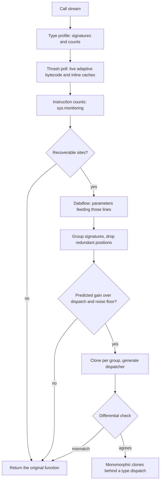
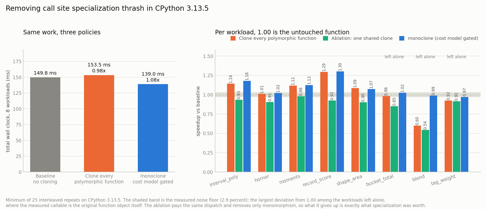

# monoclone

Find and remove call site specialization thrash in CPython 3.11 and later, by recompiling a polymorphic function into one monomorphic clone per argument type group, but only where a measured cost model says the clone pays for its dispatch.

## The problem

CPython 3.11 and later rewrite hot bytecode in place. A generic `BINARY_OP` becomes `BINARY_OP_ADD_INT` once the interpreter has seen enough int operands, a `LOAD_ATTR` caches the type version and attribute slot of the class it keeps seeing, and the fast path is a guard plus a few instructions instead of a full dispatch. This is the single largest source of interpreter speedup since 3.10 and it is entirely automatic.

It is also entirely per call site. A function called with ints and with floats has one `BINARY_OP` site serving both, and that site cannot hold two specializations at once. It specializes to int, deoptimizes on the next float, backs off, respecializes to float, deoptimizes on the next int. The guard fails on roughly every other execution and the site spends its life paying for a fast path it never gets to keep.

Nothing reports this. A release build of CPython exposes no deoptimization counters: the specialization statistics CPython developers use require a debug build compiled with `--enable-pystats`. `cProfile` reports the function as slow without saying why, and line profilers point at the line, which was never the question. So the standard advice is to keep hot functions monomorphic, with no way to find out which ones are not.

The fix is well understood in JIT literature and is called customization, or type specialized cloning: give each type its own copy of the code. What is missing in Python is not the idea, it is knowing where to apply it, because applying it everywhere is slower than doing nothing.

## What it does

`monoclone` takes a function and a stream of the calls it actually receives, and returns either a drop in replacement or the original function unchanged.

It runs three measurement passes, in this order, because each one destroys what the next needs:

1. A type profile. The function is wrapped and every call records the tuple of its argument types. Timings from this pass are discarded; the call counts and signatures are exact.
2. A thrash poll. The function runs uninstrumented while a sampling thread reads `code._co_code_adaptive`, the live quickened instruction stream, caches included. This is the only pass in which specialization state exists to be read at all.
3. An instruction count. `sys.monitoring` INSTRUCTION events give exact executions per bytecode offset. Instrumentation replaces specialized instructions with their instrumented forms, so no specialization state survives this pass, but control flow is unchanged and so the counts are right.

From those it classifies every specializable site as stable, form thrash, cache thrash, or generic; runs a dataflow analysis to find which parameters feed the thrashing lines; groups the observed type signatures on exactly those positions; predicts the gain against a calibrated dispatch cost; and, only if the prediction clears both the dispatch and the measured noise floor, recompiles the body once per group and puts a generated type dispatcher in front. Argument types the profile never saw fall through to the original function, so behaviour is unchanged for every input, and a differential check confirms that before the dispatcher is handed back.

## Why it is interesting

**The thrash detector works on a stock interpreter.** Specialization state is not exposed through any API, but it is sitting in `code._co_code_adaptive` as bytes, and polling it turns an invisible runtime property into a measurable one. No debug build, no recompile, no patched interpreter.

**Watching opcode names is not enough, and the gap is not small.** Two ordinary classes with the same attribute names both specialize `LOAD_ATTR` to `LOAD_ATTR_INSTANCE_VALUE`. The opcode never changes; only the cached type version does. A detector that compares opcode names reports that site as perfectly healthy. Polling the inline cache words behind the instruction catches it, and on the `shape_area` workload that accounts for all five of the thrashing sites, worth 1.07x. The two signals are reported separately as `form_thrash` and `cache_thrash`.

**Megamorphic sites do not thrash, they give up.** Past a handful of distinct types the interpreter stops trying, marks the site megamorphic and leaves it generic forever. It then never flips again, so a flip detector alone calls it healthy. That is why the classifier treats a stuck generic site as recoverable too, and it is how the 60 class `tag_weight` workload gets found at all.

**The cost model is the contribution, not the cloning.** Cloning is twenty lines of `ast` and `exec`. Deciding where to clone is the hard part, and getting it wrong is expensive in the direction nobody expects: cloning every polymorphic function in this benchmark is 2.4 percent *slower* than leaving all of them alone, and on a three operation body it is 1.67x slower. The model is four constants measured on the machine it runs on, and over eight workloads it got all eight accept or reject decisions right.

**Calibrating it correctly is harder than it looks.** The obvious way to measure what monomorphism is worth, one interleaved run against one run per type group, is wrong: segregating calls by type also segregates their data, and the resulting cache locality gets credited to specialization. Correcting for that dropped the measured value of container specialization by about a third. Both runs now walk the identical argument list in the identical order and differ only in which code object the call lands in.

## Architecture

[FigJam board: monoclone pipeline](https://www.figma.com/board/dDnmpDgJBOfDfIEZgKx9Il)

The diagram shows the three measurement passes, how each site is classified, how the dataflow analysis and grouping pick the dispatch key, and the two gates (the cost model and the differential check) that a clone set has to pass before it is returned.



## Results



The metric is wall clock time to execute a fixed, recorded stream of calls, which is the only thing a user of a hot function cares about. The baseline is the function left exactly as written, already warmed, in its natural steady state under the mixed call stream. Each of the eight workloads is sized so its baseline costs roughly the same, so the total weights them equally rather than by an arbitrary call count. Every number is the minimum of 25 repeats, timed round robin across the alternatives so that any drift in machine load is spread across all of them instead of landing on one.

Across the eight workloads, **149.8 ms of baseline work becomes 139.0 ms, a 1.08x speedup**. The same pipeline with the cost model switched off, which is what cloning every polymorphic function looks like, takes 153.5 ms, so it is 2.4 percent slower than changing nothing at all. Grouping, clone budget and verification are identical between the two; the decision rule is the only variable.

The aggregate understates the interesting part, which is the spread. Where the opportunity is real the gains are large: `record_score`, which loads attributes off three classes with different layouts, runs 1.30x faster. Where it is not, ungated cloning is destructive: `blend`, a three operation body, runs at 0.60x once a dispatch is bolted onto a call that costs about as much as the dispatch does. `monoclone` left `blend`, `bucket_total` and `tag_weight` alone, and all eight accept or reject decisions matched whether cloning actually helped.

The ablation bar is the load bearing control. It builds the same number of dispatches into a *single shared clone*: identical per call cost, identical generated dispatcher, with monomorphism as the only thing removed. It loses on every workload, from 0.98x down to 0.54x, which is what rules out the gains coming from the dispatch structure, the extra code object or the benchmark shape rather than from specialization.

Honest limits, all visible in `docs/metrics.json`:

| workload | recoverable ops/call | predicted | measured | verdict |
| --- | --- | --- | --- | --- |
| interval_poly | 96.0 scalar/form | 1.12x | 1.18x | cloned |
| horner | 32.0 scalar/form | 1.04x | 1.02x | cloned, inside the noise floor |
| moments | 130.0 scalar/form | 1.14x | 1.13x | cloned |
| record_score | 31.0 attribute/form | 1.20x | 1.30x | cloned, under-predicted |
| shape_area | 26.0 attribute/cache | 1.18x | 1.07x | cloned, over-predicted |
| bucket_total | 32.0 container/form | 1.03x | 1.03x | left alone |
| blend | 3.0 scalar/form | 0.85x | 0.99x | left alone, avoided 1.67x of damage |
| tag_weight | 30.0 attribute/form | 0.95x | 0.97x | left alone |

The noise floor is 2.9 percent, measured the strict way: for a workload the model left alone, the callable timed as the "after" case is the original function object itself, so its deviation from 1.00 is harness noise and nothing else. `horner` at 1.02x is therefore not a result, it is a function the model should arguably have declined; `min_gain_share` is the knob that decides how much predicted gain is worth acting on, and it defaults to 3 percent.

Two negative results worth stating plainly. First, splitting the model by thrash kind bought nothing: form thrash and cache thrash were expected to cost differently and measured 14.0 and 14.9 ns per execution, which is the same number. Second, the residual error is real and the model does not capture it. `record_score` and `shape_area` both thrash attribute loads at a similar rate, yet one gains 1.30x and the other 1.07x. The difference is that `record_score` mixes classes with different attribute *layouts*, so a failed guard has to rebuild more of the cache, while `shape_area` mixes two classes with identical layouts where only the type version differs. The cost of a failed attribute guard depends on how much of the inline cache has to be rebuilt, which is not visible in the opcode, the site class, or the thrash kind.

## How to run it

Requires CPython 3.11 or later. 3.13 is what the numbers above were taken on. The library itself needs nothing outside the standard library; `matplotlib` is only used to draw the chart.

```
git clone https://github.com/joelvarun/monoclone
cd monoclone
pip install -r requirements.txt
```

Reproduce the figure and `docs/metrics.json`:

```
python bench/run_bench.py --reps 25
```

Inspect one workload in detail, including the thrashing sites and the generated dispatcher:

```
python examples/demo.py record_score
python examples/demo.py
```

Run the correctness checks, with or without pytest:

```
python tests/test_monoclone.py
pytest tests/
```

Use it on your own function:

```python
from monoclone import optimize

def score(record, weight):
    ...

calls = [(record, 2) for record in observed_records]

faster, report = optimize(score, lambda: calls)
print(report.summary())
```

`optimize` returns `(callable, report)`. The callable is a dispatcher if cloning cleared the cost model and the original function if it did not, so it is always safe to use the return value. To look without changing anything, call `analyze` instead and read `report.sites`, each of which carries its offset, source line, instruction family, observed specialized forms, flip counts and status.

Calibration takes about half a second and is worth reusing across functions:

```python
from monoclone import analyze, calibrate

machine = calibrate()
print(machine.describe())
for fn, stream in targets:
    print(analyze(fn, stream, machine=machine).summary())
```

## Example output

`python examples/demo.py record_score`, verbatim:

```
calibrating this machine
  dispatch 110.5 ns/call, attribute/cache 14.92 ns/op (break-even 7),
  attribute/form 14.01 ns/op (break-even 8), container/form 10.24 ns/op
  (break-even 11), scalar/form 5.08 ns/op (break-even 22)

==============================================================================
record_score: attribute bundle with three different class layouts
==============================================================================
function            record_score
calls profiled      11600
type signatures     3 (ReorderedRecord/int, SlottedRecord/int, PlainRecord/int)
specializable sites 12, recoverable 4 (form_thrash)
    line 72 offset 4    LOAD_ATTR    form_thrash   LOAD_ATTR_INSTANCE_VALUE,LOAD_ATTR_SLOT
    line 74 offset 62   LOAD_ATTR    form_thrash   LOAD_ATTR_INSTANCE_VALUE,LOAD_ATTR_SLOT
    line 75 offset 90   LOAD_ATTR    form_thrash   LOAD_ATTR_INSTANCE_VALUE,LOAD_ATTR_SLOT
    line 76 offset 118  LOAD_ATTR    form_thrash   LOAD_ATTR_INSTANCE_VALUE,LOAD_ATTR_SLOT
recoverable ops/call attribute/form 31.0 (break-even 8)
decision            clone into 3 groups on positions [0]
groups              (ReorderedRecord) x3931, (SlottedRecord) x3866, (PlainRecord) x3803
coverage            100.0 percent of calls, 300 differential checks passed
predicted           gain 5.0 ms, dispatch cost 1.3 ms, net 3.8 ms

generated dispatcher
    def record_score(record, weight):
        _fn = _get(type(record))
        if _fn is None:
            return _original(record, weight)
        return _fn(record, weight)

measured            18.28 ms baseline, 14.12 ms after, 1.295x
```

Four of the twelve specializable sites are flipping between `LOAD_ATTR_INSTANCE_VALUE` and `LOAD_ATTR_SLOT`, which is the signature of a site seeing both a slotted and an ordinary class. The dataflow analysis found that only `record` feeds those lines, so `weight` is left out of the dispatch key and the generated dispatcher reads one `type()` rather than building a tuple. The eight remaining specializable sites are stable and are correctly left out of the op count.

A refusal looks like this, from `python examples/demo.py blend`:

```
calls profiled      120000
type signatures     2 (float/float, int/int)
specializable sites 3, recoverable 3 (form_thrash)
    line 106 offset 4    BINARY_OP    form_thrash   BINARY_OP_ADD_INT,BINARY_OP_ADD_FLOAT
    line 106 offset 10   BINARY_OP    form_thrash   BINARY_OP_MULTIPLY_INT,BINARY_OP_MULTIPLY_FLOAT
    line 106 offset 14   BINARY_OP    form_thrash   BINARY_OP_SUBTRACT_INT,BINARY_OP_SUBTRACT_FLOAT
recoverable ops/call scalar/form 3.0 (break-even 23)
decision            leave alone (predicted net -11.29 ms from 3.0 recoverable ops
                    per call over 100 percent of calls does not clear the 1.88 ms floor)
predicted           gain 1.7 ms, dispatch cost 13.0 ms, net -11.3 ms

measured            16.80 ms baseline, 16.66 ms after, 1.008x
```

Every operation in the body is thrashing, which is the worst possible ratio, and it still is not worth cloning: three recoverable operations per call against a break-even of 23, so the predicted 1.7 ms of specialization is swamped by 13.0 ms of dispatch. Cloning it anyway measures 0.60x.

## Limitations

- CPython 3.11 or later, and the inline cache reader assumes the 3.13 layout of `code._co_code_adaptive`. Earlier versions fall back to the opcode signal, which still works.
- Functions that close over free variables, that have no source available, or that are not plain Python functions are rejected rather than cloned. The reason is reported.
- Polling samples the specialization state, so flip counts are a lower bound. Two flips between consecutive polls look like one. This affects classification only at the margin and never the measured outcome.
- The profile describes the calls it was shown. A workload whose type mix changes later keeps working, because unseen types fall through to the original, but the clone set will be sized for the mix it saw.
- Clones multiply code objects. The budget defaults to four per function and the floor to 2 percent of calls.
